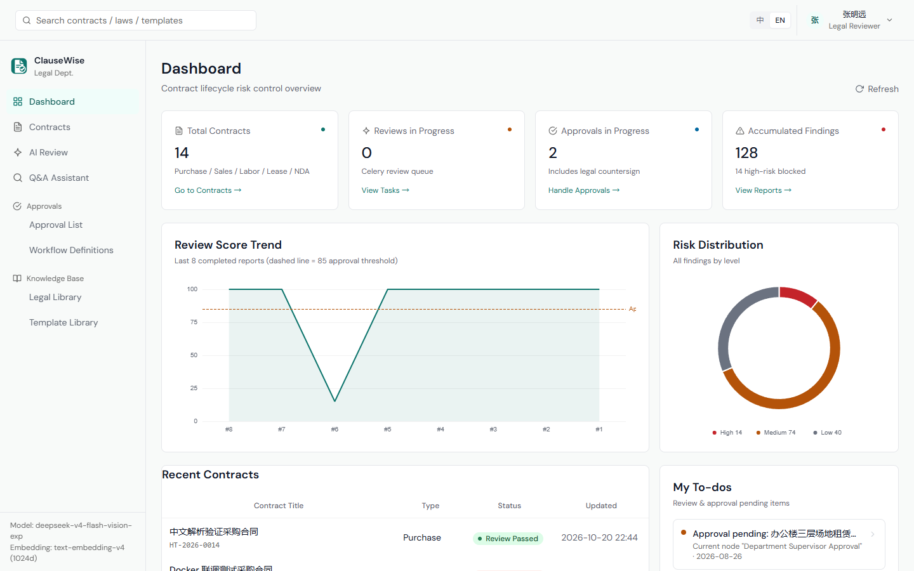
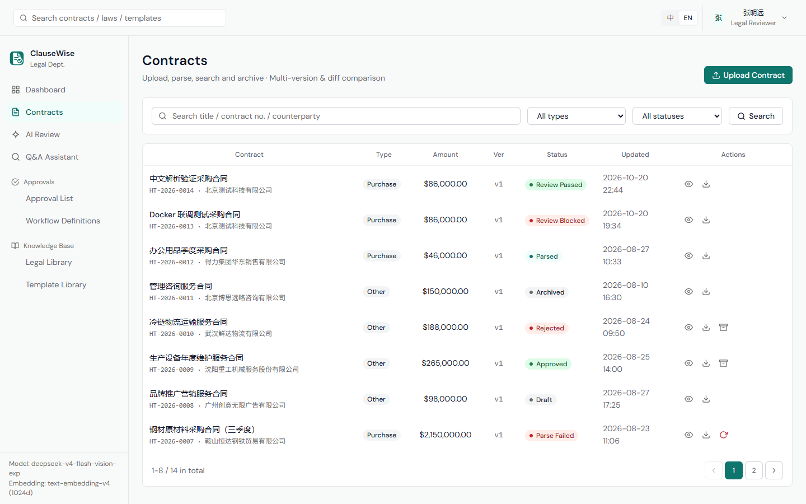
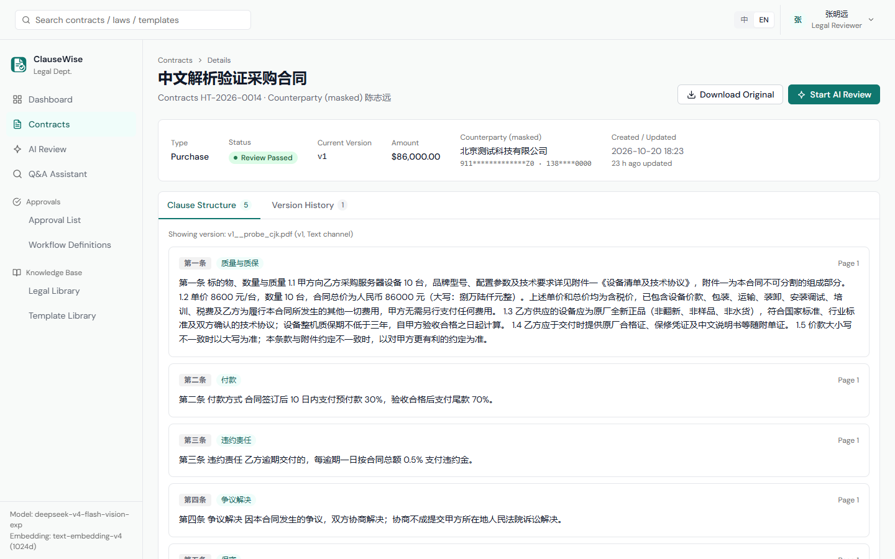
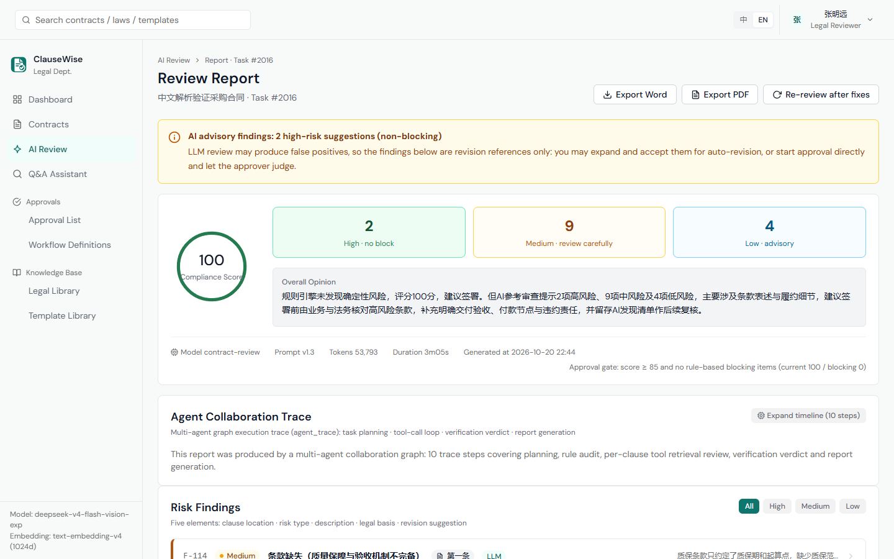
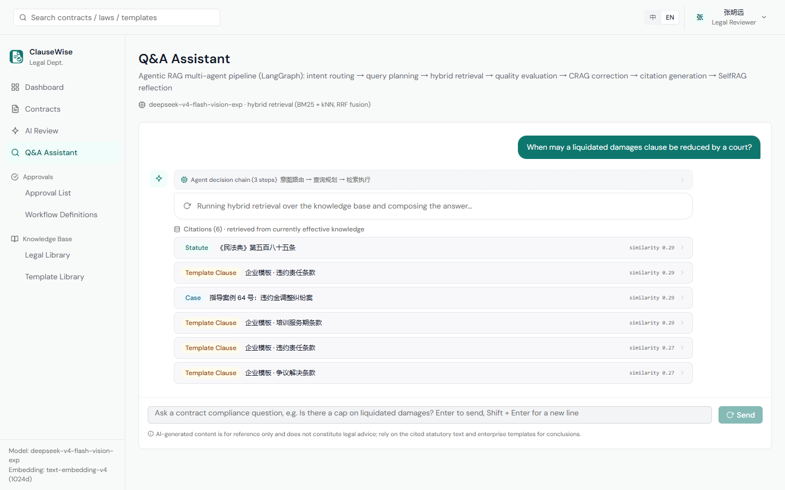
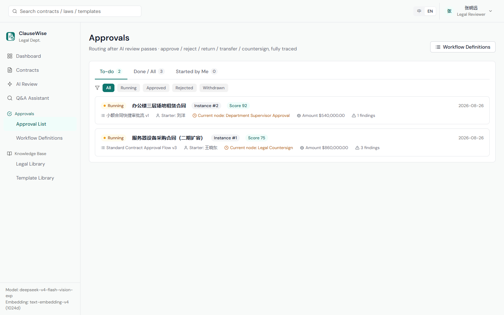
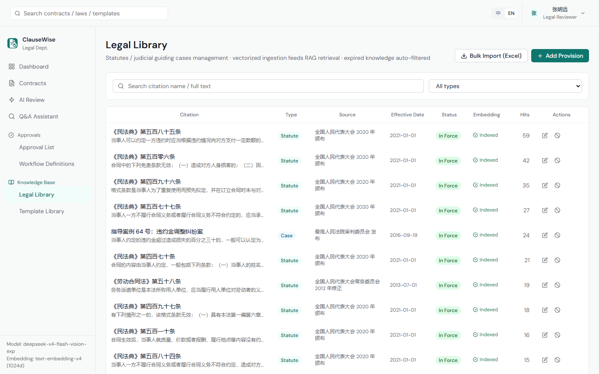
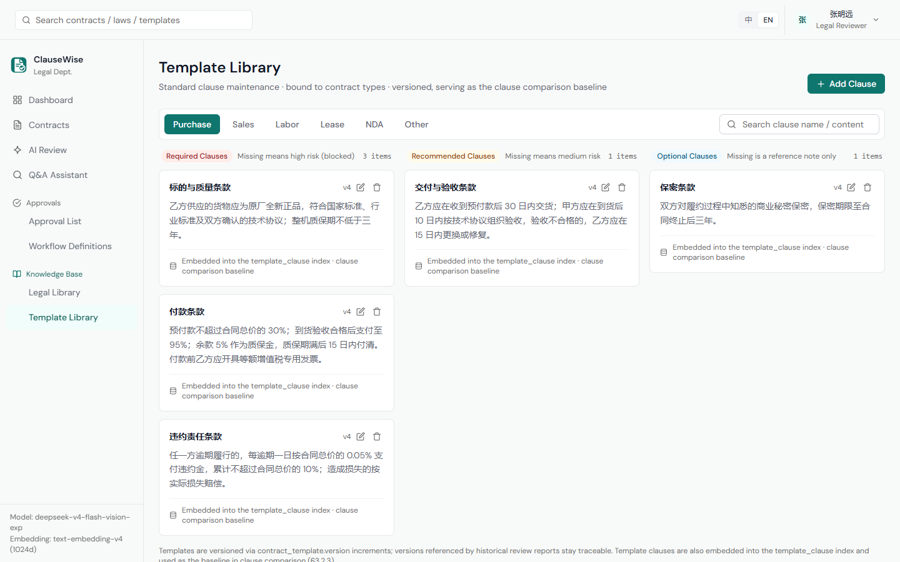
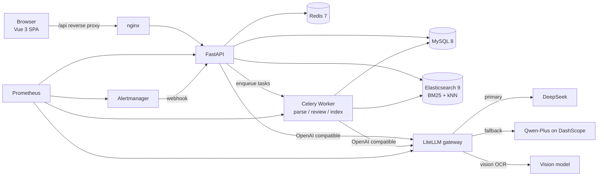
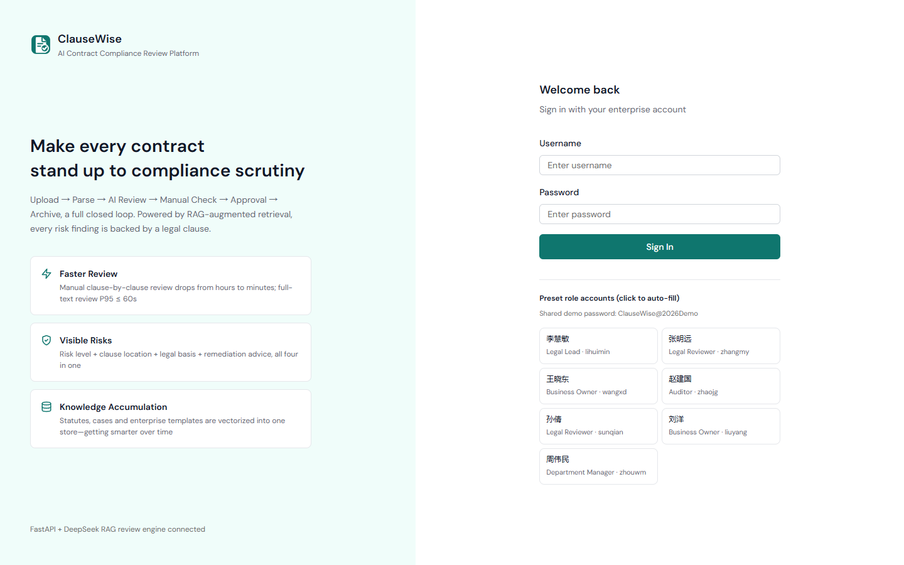

# ClauseWise · AI Contract Compliance Review Platform

[中文](README.md) | **English**

[](https://github.com/NicoYazawa/ClauseWise/actions/workflows/ci.yml) · [CI/CD and image publishing](docs/ci-cd.md)

> Upload → Parse → AI Review → Human Review → Approval → Archive, end to end.\
> A deterministic rule engine plus a LangGraph multi-agent pipeline and legal RAG — **every finding comes with a legal basis and a concrete rewrite**.



<p align="center">
  <code>FastAPI</code> · <code>LangGraph</code> · <code>Elasticsearch</code> · <code>Celery</code> · <code>Vue 3</code> · <code>Docker Compose</code>
</p>

---

## Contents

- [Features](#features)
- [Architecture](#architecture)
- [Tech stack](#tech-stack)
- [Quick start](#quick-start)
- [Project layout](#project-layout)
- [Configuration](#configuration)
- [Model integration](#model-integration)
- [Security](#security)
- [FAQ](#faq)

---

## Features

### Contract lifecycle

- Upload PDF / DOCX / scans (JPG / PNG, ≤50 MB); text layer is extracted directly, scans go through vision OCR
- Contracts are parsed into structured clauses (number, type, page, text) with parse status and channel visible
- Version chain `v1 → vN`; historical versions are immutable and always retrievable
- **Character-level diff** between any two versions, with changes highlighted
- Status machine: draft → parsing → parsed → under review → passed / rejected → archived





### AI review: rule engine + multi-agent pipeline

- **Rules run first**: deterministic hard checks are the sole basis for scoring and blocking. The LLM only adds "AI reference risks", so model hallucination can never let a bad contract through
- **Five-role LangGraph pipeline**:
  `review_planner` → `rule_auditor` → `clause_reviewer × N` (concurrent per clause) → `verifier` → `reporter`
- Every finding carries five elements: risk level, clause location, issue, legal basis, suggested rewrite
- Suggestions support **inline character-level diff**; accept to auto-rewrite the clause, or reject with a recorded reason
- **Score gate + high-risk blocking**: a contract with unresolved blocking findings cannot enter approval
- Full review / incremental review (against the previous version) / single-clause review, with live progress and timing



### Q&A: Agentic RAG

- Pipeline: intent routing → query planning → hybrid retrieval (BM25 + kNN + RRF) → relevance grading → SelfRAG reflection → answer generation → citation correction
- Streamed over SSE, with the **agent decision chain and citations visible while the answer is being written**
- Each answer is grounded in statutes, cases, or enterprise templates — expandable to the original excerpt



### Approval workflow

- Visual orchestration with approval / condition / CC nodes; or-sign, and-sign, and sequential sign-off
- Per-node timeouts plus amount and risk-score thresholds; condition nodes route automatically
- Approve / reject / return / transfer / withdraw / urge — all recorded and rendered as a timeline
- Definitions are versioned and can be enabled or disabled without affecting running instances



### Knowledge base

- **Statutes and judicial cases**: Excel bulk import, automatic chunking and vectorization into Elasticsearch
- **Enterprise clause templates**: required / recommended / optional tiers, versioned, used as the comparison baseline during review
- Expired knowledge is filtered out; hit counts support "why was this flagged" traceability





### Governance

- **RBAC**: role × permission × data scope (own / department / all), enforced at both endpoint and resource level
- **Audit log**: logins, approvals, exports, and blocked cross-tenant attempts, with IP and User-Agent
- **Model and prompt versioning**: every prompt edit produces a new version; history is browsable and activatable
- **Agent traces**: the full decision chain, tool calls, token usage, and latency of every review


### Observability

- Application metrics: review count, failure rate, end-to-end duration, parse duration, model call latency
- Gateway metrics: every LiteLLM call (including agent tool loops) and fallback counts
- Threshold alerts: API down, review failure rate, parse failure spike, gateway cooldown
- Alerts are dispatched by the app to WeCom / DingTalk / Feishu, with payloads adapted from the webhook URL

---

## Architecture



**Key decisions**:

- Review and parsing run in Celery workers; the API only orchestrates and queries, so long jobs never block requests
- All model traffic goes through the LiteLLM gateway: primary/fallback, circuit breaking, timeouts, and metrics — with zero changes in business code
- Rules and LLM are strictly separated: hard rules decide whether a contract may pass, the LLM only suggests where to look
- The frontend uses TanStack Query for caching and invalidation; running reviews poll every 5s and stop automatically

---

## Tech stack

| Layer | Choice |
|---|---|
| Backend | Python 3.12 · FastAPI ≥0.115 · SQLAlchemy 2 · pymysql · MySQL 8 |
| Agent orchestration | LangGraph ≥1.0 · LangChain ≥1.0 · langchain-openai |
| Retrieval | Elasticsearch ≥9.0 + IK analyzer (BM25 + kNN + RRF hybrid) |
| Model gateway | LiteLLM (self-built image): single egress, fallback, circuit breaking, metrics, no message logging |
| Async jobs | Celery ≥5.3 · Redis 7 (parse / review / index queues) |
| Document processing | PyMuPDF · python-docx · openpyxl · reportlab |
| Frontend | Vue 3.5 · Vite 8 (Rolldown) · TypeScript 5.9 · Pinia 4 · TanStack Query 5 · Tailwind 3 · reka-ui · motion-v · vue-i18n 11 |
| Observability | Prometheus · Alertmanager · prometheus-client |
| Tooling | uv (locked) · ruff · mypy · pytest · Vitest |

---

## Quick start

### Prerequisites

- Docker 24+ with Docker Compose v2
- At least 8 GB of free memory (Elasticsearch uses a 1 GB heap)
- A working model API key (DeepSeek / DashScope / OpenAI — any one)

### Three steps

```bash
# 1. Prepare configuration
cp .env.example .env

# 2. Fill in the required values (keep the rest as-is)
#    DEEPSEEK_API_KEY=...          chat model
#    DASHSCOPE_API_KEY=...         embedding model (required for indexing statutes)
#    SECRET_KEY=...                random string, at least 32 chars
#    BOOTSTRAP_ADMIN_PASSWORD=...  initial admin password

# 3. Build and start
docker compose up -d --build
```

Startup order is enforced by healthchecks: **MySQL / Redis / ES healthy → API (creates tables, seeds data, vectorizes) → Worker / Beat / Frontend**.

### Endpoints

| Service | URL |
|---|---|
| Frontend | http://localhost:15173 |
| API | http://localhost:18000 |
| Swagger | http://localhost:18000/docs |
| Health check | http://localhost:18000/health |
| Elasticsearch | http://localhost:19200 |
| Prometheus | http://localhost:19090 |
| LiteLLM gateway | http://localhost:14000 |

> Data-plane ports (MySQL / Redis / ES / LiteLLM / API) are bound to `127.0.0.1` only. External access goes through the frontend nginx reverse proxy, so RBAC cannot be bypassed by connecting directly.

### Accounts

- **Administrator**: `admin`, password from `BOOTSTRAP_ADMIN_PASSWORD`. **A password change is forced on first login.**
- **Demo accounts** (optional): with `PRESET_ACCOUNTS_ENABLED=true`, the login page shows one-click cards covering every role.

```bash
PRESET_ACCOUNTS_ENABLED=true
PRESET_ACCOUNT_PASSWORD=ClauseWise@2026Demo   # falls back to the built-in demo password when empty
```

> ⚠️ Demo accounts are for trials and screenshots only. **Keep `PRESET_ACCOUNTS_ENABLED=false` in production** — turning it off revokes these accounts on restart (disabled + tokens invalidated).
>
> All screenshots in this document come from a demo environment. Contracts, companies, and people shown are **fictional**.



---

## Project layout

```
ClauseWise/
├── docker-compose.yml            # full-stack orchestration
├── .env.example                  # configuration template (real .env is never committed)
├── docker/
│   ├── es/Dockerfile             # Elasticsearch + IK Chinese analyzer
│   ├── litellm/config.yaml       # gateway: aliases / fallback / circuit breaking
│   ├── prometheus/               # scrape config + alert rules
│   └── alertmanager/             # alert callback wiring
├── backend/
│   ├── app/
│   │   ├── api/                  # routes (auth / contracts / reviews / workflows / knowledge / system)
│   │   ├── agents/               # LangGraph graphs: review_graph / qa_graph
│   │   ├── ai/                   # model client, provider resolution, gateway model probing
│   │   ├── services/             # parsing, review, scoring, approval, export
│   │   ├── tasks/                # Celery tasks (parse / review / index)
│   │   ├── models/               # SQLAlchemy models
│   │   └── core/                 # config, security, audit, alerting, metrics
│   ├── scripts/init_db.py        # idempotent init: tables + seed + ES indices + vectorization
│   └── pyproject.toml
├── frontend/
│   ├── src/
│   │   ├── views/                # 19 pages
│   │   ├── components/           # UI components and layout
│   │   ├── api/                  # REST + SSE clients, queryKeys
│   │   ├── composables/          # useApiQuery / useECharts
│   │   └── stores/               # Pinia
│   ├── scripts/capture-screenshots.mjs   # regenerate bilingual screenshots
│   └── vitest.config.ts
└── docs/images/                  # README screenshots (zh / en)
```

---

## Configuration

See `.env.example` for the full list. The important ones:

| Variable | Description |
|---|---|
| `SECRET_KEY` | JWT and field-encryption key. Validated at startup: at least 32 chars and not a default value |
| `BOOTSTRAP_ADMIN_PASSWORD` | Initial admin password; a change is forced on first login |
| `MYSQL_*` | Database credentials (rewritten to `mysql:3306` inside containers) |
| `ES_URL` / `ES_USERNAME` / `ES_PASSWORD` | Search backend (rewritten to `http://es:9200` inside containers) |
| `REDIS_URL` / `REDIS_PASSWORD` | Cache and Celery broker |
| `LLM_PROVIDER` / `LLM_MODEL` | Chat provider and model (an alias when using the gateway) |
| `LLM_VISION_MODEL` | Dedicated OCR model for scans; falls back to the main model when empty |
| `EMBEDDING_PROVIDER` / `EMBEDDING_MODEL` / `EMBEDDING_DIM` | Embedding model settings |
| `PRESET_ACCOUNTS_ENABLED` | Demo accounts switch; must be `false` in production |
| `ALERT_ENABLED` / `ALERT_WEBHOOK_URL` | Event alerts (WeCom / DingTalk / Feishu / any JSON endpoint) |
| `ALERT_INGEST_TOKEN` | Shared token for Alertmanager callbacks |

---

## Model integration

### Option A (recommended): LiteLLM gateway

The application only knows aliases; real models live in `docker/litellm/config.yaml`, so switching vendors requires no code changes:

| Alias | Purpose | Default target |
|---|---|---|
| `contract-review` | Contract review / Q&A | DeepSeek |
| `contract-review-backup` | Automatic takeover when the primary fails | Qwen-Plus on DashScope |
| `contract-ocr` | Scan OCR | Vision model |
| `contract-embed` | Embeddings (reserved; direct DashScope by default) | text-embedding-v4 |

```bash
# Switch models: edit the gateway config and restart — app and frontend stay untouched
docker compose restart litellm
```

**Failover drill** (proves the fallback chain works):

```bash
curl -s -H "Authorization: Bearer $LITELLM_MASTER_KEY" -H "Content-Type: application/json" \
  -d '{"model":"drill-broken","messages":[{"role":"user","content":"ping"}]}' \
  http://localhost:14000/v1/chat/completions | grep '"model"'
# qwen-plus in the response means failover is active
```

### Option B: connect to a vendor directly

```bash
LLM_PROVIDER=deepseek        # deepseek / dashscope / openai / moonshot / zhipu / siliconflow / volcengine / ollama / custom
LLM_MODEL=deepseek-chat
DEEPSEEK_API_KEY=sk-xxx
```

Restart the backend containers afterwards: `docker compose up -d --force-recreate api worker beat`.

---

## Security

- **No secrets in the repo**: `.env`, `*.key`, database dumps, and runtime logs are all git-ignored; images only `COPY app scripts`, never configuration
- **Fail-fast validation**: the app refuses to start when `SECRET_KEY` is shorter than 32 chars or left at a default value
- **Minimal exposure**: MySQL / Redis / ES / LiteLLM / API bind to `127.0.0.1` only
- **Resource-level RBAC**: not just "can you call this endpoint", but "is this record yours" (cross-user access returns 403)
- **Model-side compliance**: the gateway sets `turn_off_message_logging: true` and only records model, latency, tokens, and status — **contract text never reaches gateway logs**
- **Full audit trail**: logins, approvals, exports, and blocked attempts are written to `audit_log` with IP and UA
- **Password policy**: bcrypt hashing, forced first-login change, revocable demo accounts

---

## FAQ

**API stuck at `health: starting`**\
Check `docker compose logs api` for the preflight report. An unreachable model API only produces a warning (`PREFLIGHT_STRICT=false`); if it is stuck waiting for MySQL, verify `docker compose ps mysql` is healthy.

**Retrieval returns nothing**\
Usually an invalid `DASHSCOPE_API_KEY`, so statutes were never vectorized. Fix the key, then run `docker compose exec api python scripts/init_db.py` (idempotent, fills in missing vectors).

**Poor Chinese search quality**\
Verify the IK plugin is installed: `curl http://localhost:19200/_cat/plugins?v` should list `analysis-ik`; without it the app falls back to the standard analyzer.

**Celery tasks stay pending**\
Check `docker compose logs worker` to confirm the `parse,review,index` queues are consumed, and that Redis is reachable.

**Backend code changes have no effect**\
Code is baked into the image; rebuild with `docker compose build api && docker compose up -d api` (same for worker / beat).

**Login says "invalid username or password"**\
The demo password comes from `PRESET_ACCOUNT_PASSWORD`, falling back to the built-in `ClauseWise@2026Demo` when empty. The admin password is `BOOTSTRAP_ADMIN_PASSWORD`, and a change is required on first login.

---

<p align="center">
  <sub>ClauseWise · every contract, built to pass compliance</sub>
</p>
