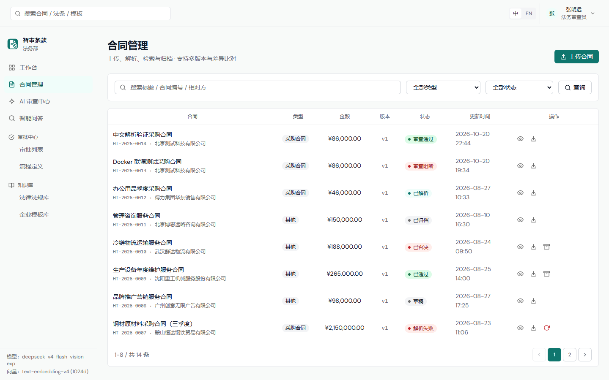
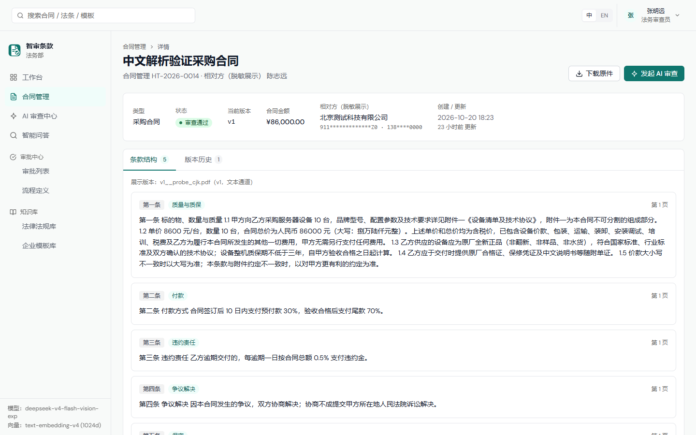
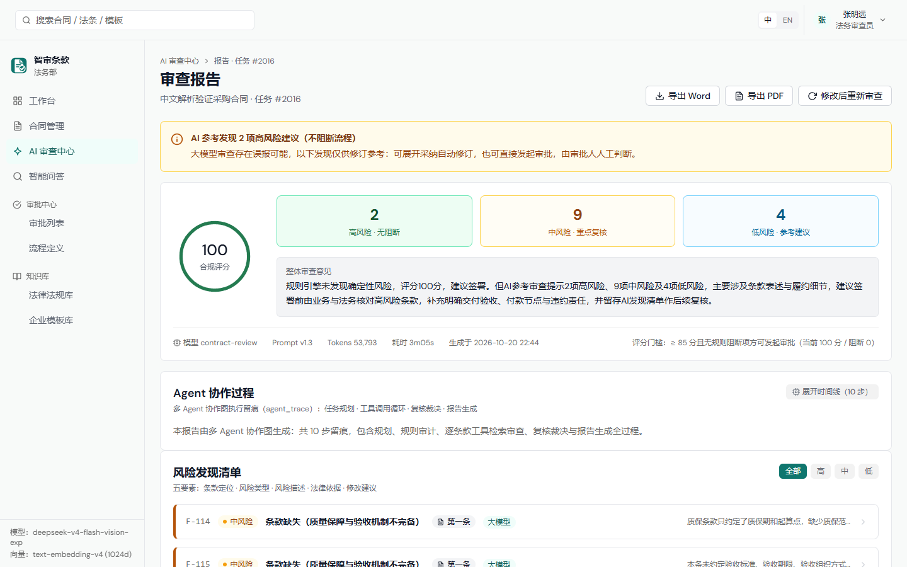
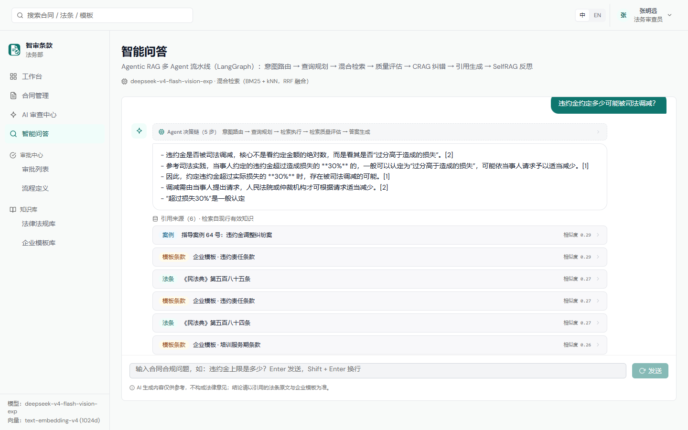
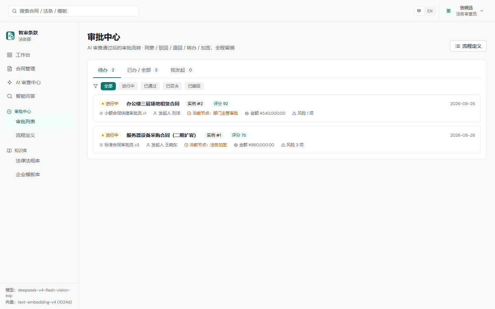
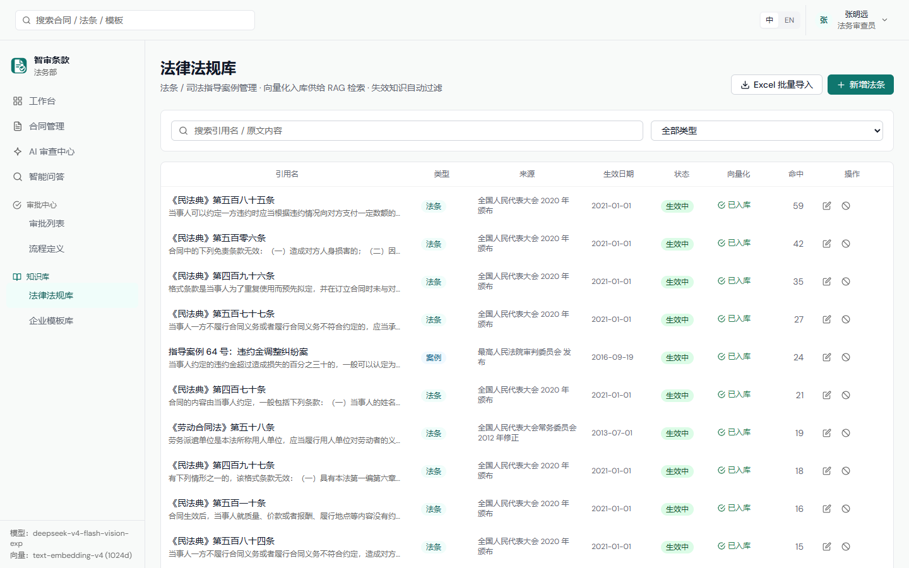
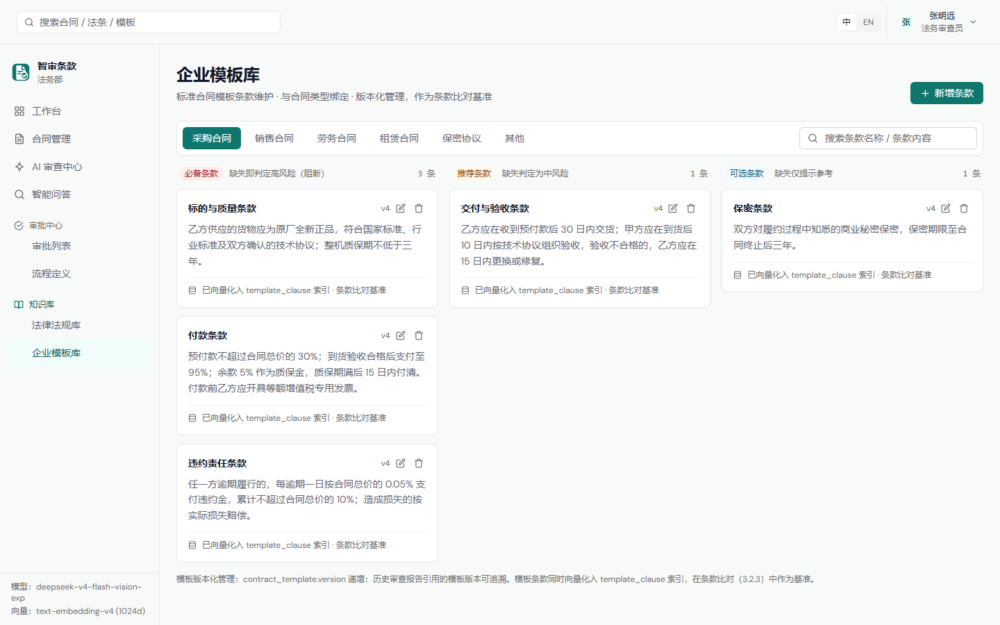
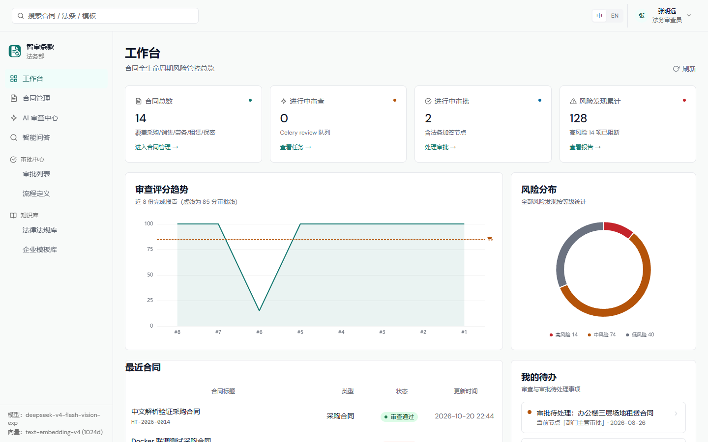
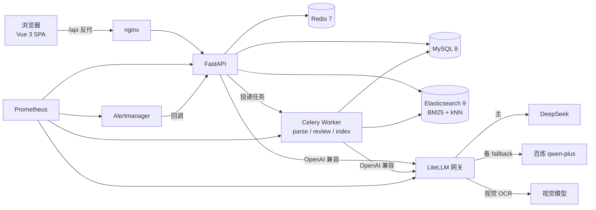
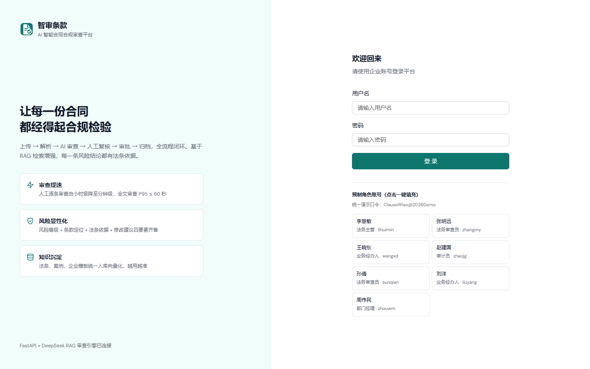

# ClauseWise · AI 智能合同合规审查平台

**中文** | [English](README.en.md)

[](https://github.com/NicoYazawa/ClauseWise/actions/workflows/ci.yml) · [CI/CD 与镜像发布](docs/ci-cd.md)

> 上传 → 解析 → AI 审查 → 人工复核 → 审批 → 归档，全流程闭环。\
> 规则引擎兜底 + LangGraph 多 Agent 协作 + 法条 RAG 检索，**每一条风险都有法条依据和改写建议**。


<p align="center">
  <code>FastAPI</code> · <code>LangGraph</code> · <code>Elasticsearch</code> · <code>Celery</code> · <code>Vue 3</code> · <code>Docker Compose</code>
</p>

---

## 目录

- [功能](#功能)
- [系统架构](#系统架构)
- [技术栈](#技术栈)
- [快速开始](#快速开始)
- [目录结构](#目录结构)
- [配置说明](#配置说明)
- [模型接入](#模型接入)
- [安全设计](#安全设计)
- [常见问题](#常见问题)

---

## 功能

### 合同全生命周期

- 支持 PDF / DOCX / 扫描件（JPG / PNG，≤50MB）上传，自动识别文本层或走视觉 OCR
- 解析为结构化条款（条款号、类型、页码、正文），解析状态与渠道可视化
- 版本链 `v1 → vN`，历史版本不可变，可随时回溯
- 任意两个版本做**字符级差异对比**，变更点高亮
- 合同状态机：草稿 → 解析中 → 已解析 → 审查中 → 通过 / 驳回 → 归档





### AI 审查：规则引擎 + 多 Agent 协作

- **规则引擎先行**：确定性硬校验是评分与阻断的唯一依据，LLM 只补充「AI 参考风险」，避免模型幻觉影响放行结论
- **LangGraph 五角色协作**：
  `review_planner`（规划） → `rule_auditor`（规则审计） → `clause_reviewer × N`（逐条并发审查） → `verifier`（复核裁决） → `reporter`（报告生成）
- 每条风险输出五要素：风险等级、条款定位、问题描述、法条依据、修改建议
- 修改建议支持**字符级 diff**，可一键采纳并自动改写条款，或拒绝并记录理由
- **90 分门槛 + 高风险阻断**：存在未闭环的阻断项时，不允许提交审批
- 支持全文审查 / 增量审查（对比上一版）/ 单条款审查，任务进度与耗时实时可见



### 智能问答：Agentic RAG

- 决策链：意图路由 → 查询规划 → 混合检索（BM25 + kNN + RRF）→ 相关性评分 → SelfRAG 反思 → 答案生成 → 引用纠错
- SSE 流式输出，**Agent 决策过程与引用来源实时可见**（不是黑盒回答）
- 每条回答附带法条 / 案例 / 企业模板引文，可展开查看原文片段



### 审批流

- 可视化编排：审批 / 条件 / 抄送节点；支持或签、与签、顺序会签
- 节点可配置超时、金额阈值、风险分阈值，条件节点自动路由
- 同意 / 驳回 / 退回 / 转办 / 撤回 / 催办，全链路留痕并生成审批时间线
- 流程定义支持版本化发布、启停，运行中实例不受影响



### 知识库

- **法律法规 + 司法案例**：Excel 批量导入，自动分片、向量化入 Elasticsearch
- **企业合同模板**：必备 / 推荐 / 可选三级管理，版本化，供 Agent 审查时比对
- 失效知识自动过滤，命中次数统计，支撑「为什么这么判」的溯源





### 系统治理

- **RBAC**：角色 × 权限 × 数据范围（本人 / 本部门 / 全部），接口级与资源级双重校验
- **审计日志**：登录、审批、导出、越权尝试全量记录，含 IP 与 User-Agent
- **模型与 Prompt 版本管理**：Prompt 改动即新版本，可查看历史、切回生效版本
- **Agent 协作留痕**：每次审查的完整决策链、工具调用、token 与耗时



### 可观测性

- 应用侧指标：审查任务数 / 失败率 / 端到端耗时 / 解析耗时 / 模型调用耗时
- 网关侧指标：LiteLLM 全量调用（含 Agent 工具循环）、fallback 次数
- 阈值告警：API 掉线、审查失败率、解析失败激增、网关熔断
- 告警经应用统一转企微 / 钉钉 / 飞书，按 URL 自动适配载荷

---

## 系统架构



**关键设计**：

- 审查 / 解析跑在 Celery Worker，API 只负责编排与查询，长任务不阻塞请求
- 所有模型调用经 LiteLLM 网关：主备 fallback、熔断、超时治理、指标，业务代码零改动
- 规则引擎与 LLM 分离：硬规则决定「能不能放行」，LLM 只提供「建议看看这里」
- 前端用 TanStack Query 统一缓存与失效，审查任务 5s 轮询，完成后自动停止

---

## 技术栈

| 层 | 选型 |
|---|---|
| 后端 | Python 3.12 · FastAPI ≥0.115 · SQLAlchemy 2 · pymysql · MySQL 8 |
| Agent 编排 | LangGraph ≥1.0 · LangChain ≥1.0 · langchain-openai |
| 检索 | Elasticsearch ≥9.0 + IK 中文分词（BM25 + kNN + RRF 混合检索） |
| 模型网关 | LiteLLM（自建镜像）：统一出口 / 主备 fallback / 熔断 / 指标 / 不落消息体 |
| 异步任务 | Celery ≥5.3 · Redis 7（parse / review / index 三队列） |
| 文档处理 | PyMuPDF · python-docx · openpyxl · reportlab |
| 前端 | Vue 3.5 · Vite 8（Rolldown）· TypeScript 5.9 · Pinia 4 · TanStack Query 5 · Tailwind 3 · reka-ui · motion-v · vue-i18n 11 |
| 可观测 | Prometheus · Alertmanager · prometheus-client |
| 工具链 | uv（锁文件）· ruff · mypy · pytest · Vitest |

---

## 快速开始

### 前置要求

- Docker 24+ 与 Docker Compose v2
- 至少 8GB 可用内存（ES 单节点占 1GB 堆）
- 一个可用的模型 API Key（DeepSeek / 百炼 / OpenAI 任一即可）

### 三步启动

```bash
# 1. 准备配置
cp .env.example .env

# 2. 填写必填项（其余保持默认即可）
#    DEEPSEEK_API_KEY=...      对话模型
#    DASHSCOPE_API_KEY=...     向量模型（法条入库必需）
#    SECRET_KEY=...            ≥32 位随机串
#    BOOTSTRAP_ADMIN_PASSWORD=...  初始管理员口令

# 3. 构建并启动
docker compose up -d --build
```

启动顺序由 healthcheck 保证：**MySQL / Redis / ES 健康 → API（自动建表 + 种子数据 + 向量化）→ Worker / Beat / Frontend**。

### 访问地址

| 服务 | 地址 |
|---|---|
| 前端（用户入口） | http://localhost:15173 |
| 后端 API | http://localhost:18000 |
| Swagger 文档 | http://localhost:18000/docs |
| 健康检查 | http://localhost:18000/health |
| Elasticsearch | http://localhost:19200 |
| Prometheus | http://localhost:19090 |
| LiteLLM 网关 | http://localhost:14000 |

> 数据面端口（MySQL / Redis / ES / LiteLLM / API）均只绑定 `127.0.0.1`，对外统一走前端 nginx 反代，避免绕过 RBAC 直连。

### 登录账号

- **管理员**：`admin`，口令为 `.env` 中的 `BOOTSTRAP_ADMIN_PASSWORD`，**首次登录强制改密**
- **演示账号**（可选）：`PRESET_ACCOUNTS_ENABLED=true` 时，登录页会展示一键填充卡片，覆盖全部角色

```bash
PRESET_ACCOUNTS_ENABLED=true
PRESET_ACCOUNT_PASSWORD=ClauseWise@2026Demo   # 留空回落到内置演示口令
```

> ⚠️ 演示账号仅用于试用与截图，**生产环境必须保持 `PRESET_ACCOUNTS_ENABLED=false`**。关闭后重启会回收这些账号（停用 + 令牌失效）。
>
> 本文档中的截图均来自演示环境，合同、客户、人员信息**全部为虚构数据**。



---

## 目录结构

```
ClauseWise/
├── docker-compose.yml            # 全栈编排
├── .env.example                  # 配置模板（真实 .env 不入库）
├── docker/
│   ├── es/Dockerfile             # Elasticsearch + IK 中文分词
│   ├── litellm/config.yaml       # 模型网关：别名 / fallback / 熔断
│   ├── prometheus/               # 抓取配置 + 阈值告警规则
│   └── alertmanager/             # 告警回调入口配置
├── backend/
│   ├── app/
│   │   ├── api/                  # 路由层（auth / contracts / reviews / workflows / knowledge / system）
│   │   ├── agents/               # LangGraph 图：review_graph / qa_graph
│   │   ├── ai/                   # 模型客户端、厂商解析、网关模型探测
│   │   ├── services/             # 解析、审查、评分、审批、导出等业务服务
│   │   ├── tasks/                # Celery 任务（parse / review / index）
│   │   ├── models/               # SQLAlchemy 模型
│   │   └── core/                 # 配置、安全、审计、告警、指标
│   ├── scripts/init_db.py        # 幂等初始化：建表 + 种子 + ES 索引 + 向量化
│   └── pyproject.toml
├── frontend/
│   ├── src/
│   │   ├── views/                # 19 个页面
│   │   ├── components/           # UI 组件 / 布局
│   │   ├── api/                  # REST + SSE 封装、queryKeys
│   │   ├── composables/          # useApiQuery / useECharts
│   │   └── stores/               # Pinia
│   ├── scripts/capture-screenshots.mjs   # 一键重生成中英双语截图
│   └── vitest.config.ts
└── docs/images/                  # README 截图（zh / en）
```

---

## 配置说明

完整项见 `.env.example`，关键项：

| 变量 | 说明 |
|---|---|
| `SECRET_KEY` | JWT 与字段加密密钥，启动时校验：必须 ≥32 字符且非默认值 |
| `BOOTSTRAP_ADMIN_PASSWORD` | 初始管理员口令，首次登录强制改密 |
| `MYSQL_*` | 数据库账号（容器内自动改写为 `mysql:3306`） |
| `ES_URL` / `ES_USERNAME` / `ES_PASSWORD` | 检索服务连接（容器内自动改写为 `http://es:9200`） |
| `REDIS_URL` / `REDIS_PASSWORD` | 缓存与 Celery Broker |
| `LLM_PROVIDER` / `LLM_MODEL` | 对话模型厂商与模型名（使用网关时为别名） |
| `LLM_VISION_MODEL` | 扫描件 OCR 专用模型，留空复用主模型 |
| `EMBEDDING_PROVIDER` / `EMBEDDING_MODEL` / `EMBEDDING_DIM` | 向量模型配置 |
| `PRESET_ACCOUNTS_ENABLED` | 演示账号开关，生产必须 `false` |
| `ALERT_ENABLED` / `ALERT_WEBHOOK_URL` | 事件告警（企微 / 钉钉 / 飞书 / 任意 JSON 端点） |
| `ALERT_INGEST_TOKEN` | Alertmanager 回调应用的共享令牌 |

---

## 模型接入

### 方案 A（推荐）：LiteLLM 网关

应用侧只认别名，真实模型在 `docker/litellm/config.yaml` 中维护，换厂商不改代码：

| 别名 | 用途 | 默认指向 |
|---|---|---|
| `contract-review` | 合同审查 / 智能问答 | DeepSeek |
| `contract-review-backup` | 主模型故障时自动接管 | 百炼 qwen-plus |
| `contract-ocr` | 扫描件 OCR | 视觉模型 |
| `contract-embed` | 向量（预留，默认仍直连百炼） | text-embedding-v4 |

```bash
# 换模型：改 gateway 配置后重启，应用与前端无感
docker compose restart litellm
```

**故障演练**（验证 fallback 真的生效）：

```bash
curl -s -H "Authorization: Bearer $LITELLM_MASTER_KEY" -H "Content-Type: application/json" \
  -d '{"model":"drill-broken","messages":[{"role":"user","content":"ping"}]}' \
  http://localhost:14000/v1/chat/completions | grep '"model"'
# 返回 qwen-plus 即表示主备切换生效
```

### 方案 B：直连厂商

```bash
LLM_PROVIDER=deepseek        # deepseek / dashscope / openai / moonshot / zhipu / siliconflow / volcengine / ollama / custom
LLM_MODEL=deepseek-chat
DEEPSEEK_API_KEY=sk-xxx
```

改完重启后端容器：`docker compose up -d --force-recreate api worker beat`。

---

## 安全设计

- **密钥零入库**：`.env` / `*.key` / 数据库导出 / 运行日志均在 `.gitignore` 中；镜像只 `COPY app scripts`，不含配置
- **启动即校验**：`SECRET_KEY` 少于 32 位或为默认值时直接拒绝启动
- **端口最小暴露**：MySQL / Redis / ES / LiteLLM / API 仅绑定 `127.0.0.1`
- **资源级 RBAC**：不只是「能不能调接口」，还校验「这条数据是不是你的」（跨用户读写返回 403）
- **模型侧合规**：网关 `turn_off_message_logging: true`，只记模型名 / 耗时 / token / 状态码，**合同原文不进网关日志**
- **全量审计**：登录、审批、导出、越权尝试写入 `audit_log`，含 IP 与 UA
- **口令策略**：bcrypt 哈希、首登强制改密、演示账号可一键回收

---

## 常见问题

**API 一直 `health: starting`**\
`docker compose logs api` 查看预检报告。模型 API 不可达只会告警（`PREFLIGHT_STRICT=false`）；若卡在「等待 MySQL」，检查 `docker compose ps mysql` 是否 healthy。

**知识库检索 0 命中**\
多为 `DASHSCOPE_API_KEY` 无效导致法条未向量化。修正后执行 `docker compose exec api python scripts/init_db.py`（幂等，会补齐向量化）。

**ES 中文检索效果差**\
确认 IK 插件已装：`curl http://localhost:19200/_cat/plugins?v` 应出现 `analysis-ik`；未装时自动回退 standard 分词器。

**Celery 任务一直 pending**\
`docker compose logs worker` 确认已消费 `parse,review,index` 三队列；确认 Redis 可连通。

**改了后端代码不生效**\
代码在镜像内，需要重新构建：`docker compose build api && docker compose up -d api`（worker / beat 同理）。

**登录提示「用户名或密码错误」**\
演示账号口令由 `PRESET_ACCOUNT_PASSWORD` 决定，留空时回落到内置 `ClauseWise@2026Demo`；管理员口令看 `BOOTSTRAP_ADMIN_PASSWORD`，首登需改密。

---

<p align="center">
  <sub>ClauseWise · 让每一份合同都经得起合规检验</sub>
</p>
